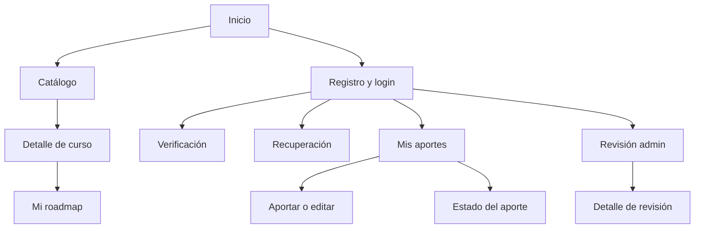

# APPFlow — Cursos Abiertos

Versión 2.0. Navegación prevista. Las rutas UI no son rutas API. Todas las API siguientes llevan prefijo `/api/v1`, definido en BackendSchema.

## 1. Sitemap

Las flechas desde auth expresan acceso tras sesión válida, no ejecución automática de acciones. Roadmap personal no se publica ni se sigue.

## 2. Rutas

| Ruta UI | Pantalla | Login/rol |
| --- | --- | --- |
| / | Inicio | Pública |
| /catalogo | Catálogo paginado | Pública |
| /catalogo/:id | Ficha publicada | Pública |
| /registro | Registro | Pública |
| /login | Login | Pública |
| /verificar-correo | Confirmación con token en fragmento | Pública |
| /reenviar-verificacion | Reenvío | Pública |
| /recuperar-contrasena | Solicitud | Pública |
| /restablecer-contrasena | Nueva contraseña con fragmento | Pública |
| /mi-roadmap | Recorrido privado paginado | Usuario verificado |
| /mis-aportes | Listado propio paginado | Usuario verificado |
| /aportar | Nuevo curso | Usuario verificado |
| /mis-aportes/:id | Estado y datos propios | Propietario |
| /mis-aportes/:id/editar | Formulario propio | Propietario; draft/rejected/published |
| /revision | Pendientes paginados | Admin |
| /revision/:id | Validar aporte | Admin; no aprobar/rechazar propios |

404 y acceso denegado son estados de ruta, no funciones adicionales. No hay pantalla de administración de categorías P0.

## 3. Fichas de pantalla

Todas usan header, mensajes y foco de UX-UI. Al entrar en área privada consultar GET /auth/me; mutaciones obtienen CSRF de GET /auth/csrf. Permisos también en servidor.

| Pantalla | Objetivo/componentes | API | Estados y navegación |
| --- | --- | --- | --- |
| Inicio | Buscar; buscador y CTA aportar | Ninguna necesaria hasta buscar | Buscar dirige catálogo con q; aportar dirige auth o formulario. |
| Catálogo | Descubrir; filtros/cards/paginador | GET /courses; GET /categories | Loading/ok/empty/error; ficha, agregar propio y aportar. Categorías con cargar más. |
| Ficha | Evaluar; metadatos/link/CTA | GET /courses/{id}; POST /me/roadmap/items tras consultar versión propia | Loading/ok/404/error; volver a filtros; sin sesión login con retorno. |
| Registro | Crear identidad; nombre/email/password | POST /auth/register | Inicial/enviando/422/429/202 genérico; reenvío, login o recuperación. |
| Login | Ingresar; email/password | POST /auth/login | Inicial/enviando/401/403 correo/429/503; éxito destino seguro o mi-roadmap. |
| Verificar correo | Confirmar; botón explícito | POST /auth/verify-email | Sin token/inicial/confirmando/ok/inválido; login o reenvío; GET no confirma. |
| Reenvío | Pedir enlace; email | POST /auth/resend-verification | Enviando/202/422/429/error; volver login. |
| Recuperación | Recuperar acceso; email | POST /auth/forgot-password | Enviando/202/422/429/error; volver login. |
| Restablecimiento | Cambiar password; nueva/confirmación | POST /auth/reset-password | Token ausente/inválido/enviando/ok/422; éxito login sin sesión automática. |
| Mi roadmap | Planificar; items/orden/avance/paginador | GET /me/roadmap; POST /me/roadmap/items/{id}/move; PATCH /me/roadmap/items/{id}; DELETE /me/roadmap/items/{id} | Loading/ok/empty/error/409; catálogo, ficha o confirmación de retiro; aviso de no disponible. |
| Mis aportes | Ver estados; filtros/cards/CTA | GET /me/courses | Loading/ok/empty/error; alta, detalle o edición. |
| Aportar | Cargar metadatos; formulario | GET /categories; POST /me/courses; POST /me/courses/{id}/submit | Inicial/guardando/borrador guardado/422/409/error; guardar crea borrador, enviar primero guarda y luego submit con nueva versión. |
| Estado propio | Entender revisión; ficha/motivo | GET /me/courses/{id}; DELETE /me/courses/{id} | Loading/ok/404/error/409; editar si habilitado, reenviar desde edición, archivar confirmado. |
| Editar propio | Corregir; formulario, aviso despublicación | GET /me/courses/{id}; GET /categories; GET /categories/{id}; PATCH /me/courses/{id}; POST /me/courses/{id}/submit | Loading/dirty/enviando/422/409; conservar texto al fallar; publicado requiere confirmar retiro temporal; volver detalle. |
| Pendientes | Revisar cola; tabla/cards/paginador | GET /admin/reviews | Loading/ok/empty/error/403; abrir revisión. |
| Detalle revisión | Aprobar/rechazar; metadatos/check/link/motivo | GET /admin/reviews/{id}; POST /admin/reviews/{id}/decision; DELETE /admin/courses/{id} | Loading/ok/422/403 auto-revisión/409/error; confirmación y retorno a pendientes. |

Cerrar sesión desde header: POST /auth/logout, borrar caché privada y volver inicio. Datos de cuenta en menú desde /auth/me, no pantalla nueva. Antes de agregar desde ficha, GET /me/roadmap devuelve version; luego POST /me/roadmap/items y actualizar vista. Una respuesta 409 de duplicado se muestra como “Este curso ya está en tu roadmap”.

## 4. Flujos completos

### 4.1 Aportar curso

1. Usuario verificado abre /aportar; obtiene categorías paginadas.
2. Completa metadatos y declaración sí/no de toma; campos no informados permitidos solo según PRD.
3. Guardar borrador hace POST /me/courses; tras 201 guardar id/version en estado de UI y navegar a edición si continúa. Así reintentar envío no crea otra alta.
4. Enviar hace submit sobre id guardado, expected_version vigente; resultado in_review dirige estado del aporte.
5. Si falla validación, mantener texto y señalar campos. Si falla red tras alta, indicar resultado incierto y revisar Mis aportes antes de repetir. URL única reduce duplicación pero no garantiza idempotencia de un alta sin URL.
6. Autor consulta resultado; rechazo muestra motivo. Editar rejected vuelve draft; guardar y enviar nuevamente. In_review solo consulta/retiro.

### 4.2 Descubrir y organizar

1. Visitante busca catálogo y abre ficha publicada.
2. Agregar sin sesión lleva login con returnTo interno; tras login volver a ficha y usuario confirma acción, sin ejecutarla automáticamente.
3. Obtener version del roadmap propio y agregar curso; 201 confirma, 409 duplicado informa sin repetir.
4. En /mi-roadmap mover con botones o posición global; petición move desplaza items aunque cambien de página. Reconsultar tras respuesta.
5. Cambiar avance PATCH y actualizar summary; quitar pide confirmar pérdida del progreso del item, DELETE y reconsultar. Si la última página queda vacía volver a anterior.
6. Curso retirado del catálogo conserva item/título/avance con aviso; no abre enlace ni cambia progreso hasta publicación nueva, pero se puede quitar.

### 4.3 Validar aporte

1. Admin abre pendientes y selecciona curso; si es propio no puede aprobar/rechazar.
2. Abre enlace externo por acción explícita; comprueba contenido gratuito, metadatos y disponibilidad.
3. Aprueba con confirmación url_checked o rechaza con motivo de 10–1000 caracteres.
4. POST decision con expected_version actual; transacción guarda revisión y estado. Aprobado aparece catálogo; rechazado solo autor/admin.
5. 409 indica que cambió mientras se revisaba: recargar antes de decidir. Si falla red, reconsultar estado, no afirmar aprobación.

### 4.4 Registro y verificación

1. Registrar y mostrar 202 genérico con enlace a reenvío/login/recuperación.
2. Abrir email de Mailpit, capturar token del fragmento y limpiar URL del historial; conservar solo en memoria.
3. Botón Confirmar envía token con CSRF; éxito lleva a login sin emitir JWT.
4. Token inválido/vencido/usado ofrece reenvío; 202 del reenvío no confirma existencia de cuenta.

### 4.5 Recuperar contraseña

1. Email y 202 genérico, cuenta exista o no.
2. Abrir enlace y limpiar fragmento; nueva contraseña y confirmación.
3. POST reset consume token y revoca sesiones; login con nueva clave. Correo pendiente sigue requiriendo verificación.
4. Vencido/usado: nueva solicitud. SMTP local fallido: reintento; no prometer entrega por haber recibido 202.

## 5. Estados globales

| Situación | Comportamiento |
| --- | --- |
| Ruta privada sin sesión/401 | Limpiar datos privados y login; returnTo solo ruta interna permitida. |
| 403 | Conservar sesión si válida y mostrar permiso insuficiente o correo pendiente según código. |
| 404 | Recurso no disponible, volver a listado; no revelar título ajeno. |
| 409 | Mantener texto en memoria, avisar cambio y ofrecer recargar; no sobrescribir silenciosamente. |
| 422 | Resumen enfocable y error junto al campo. |
| 429 | Mostrar espera de Retry-After y reintento manual. |
| Error red/503 | Conservar texto no secreto en memoria; reintentar, sin confirmar guardado incierto. |

Tokens de enlaces/password no se guardan en storage. Limpiar tokens del fragmento implica que recargar exige reabrir correo; indicar esta salida. Advertir cambios sin guardar; no prometer persistencia si se cierra navegador.
