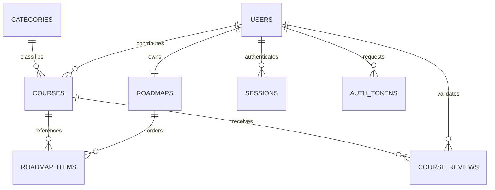
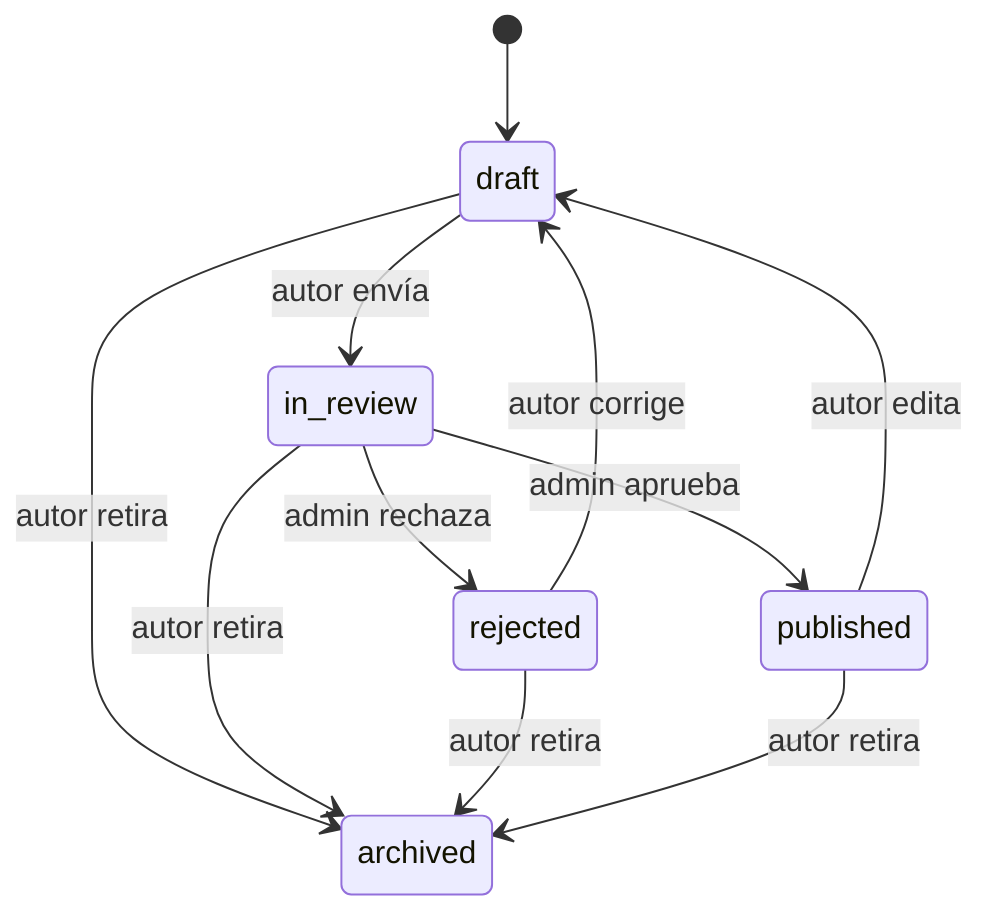

# BackendSchema — Cursos Abiertos

Versión 2.0. Contrato futuro de PostgreSQL y API, coherente con PRD v2.0; no es una migración ejecutada.

## 1. Modelo de datos

### 1.1 Diagrama entidad-relación

### 1.2 Convenciones y tablas

UUID en entidades; timestamp es timestamptz UTC. Campos no nulos salvo indicación. PK/UNIQUE/FK/CHECK son restricciones reales por implementar. created_at/updated_at obligatorios en users, courses, roadmaps; version entero >=1 para control de cambios de courses/roadmaps. El servidor deriva autor/propietario/revisor de identidad, nunca del body. Campos extra se rechazan. No devolver hashes.

#### users

| Campo | Tipo/restricción | Propósito |
| --- | --- | --- |
| id | UUID PK | Identidad. |
| email | varchar(254) UNIQUE | Recortado y comparado sin mayúsculas; no quitar puntos/sufijos. |
| display_name | varchar(80) | Nombre de 2–80. |
| password_hash | text | Argon2id. |
| role | text CHECK student/admin | Registro siempre student. |
| is_active | boolean default true | Desactivar revoca sesiones. |
| email_verified_at | timestamp nullable | Controla acceso privado. |
| password_changed_at | timestamp | Auditoría. |
| created_at, updated_at | timestamp | Fechas. |

#### categories

id UUID PK, name varchar(100) UNIQUE NOT NULL. Lista inicial precargada por seed; sin endpoints de escritura P0. UNIQUE por nombre normalizado. GET paginado y opciones seleccionadas resueltas por detalle.

#### courses

| Campo | Tipo/restricción | Observación |
| --- | --- | --- |
| id | UUID PK | Curso y aporte son la misma entidad. |
| created_by | UUID FK users RESTRICT | Autor inmutable. |
| category_id | UUID FK categories RESTRICT nullable en borrador | Obligatorio al enviar. |
| title | varchar(150) NOT NULL | 3–150. |
| topic | varchar(100) nullable borrador | Tema, 2–100 al enviar. |
| provider | varchar(100) nullable borrador | 2–100. |
| summary, description | varchar(300), text nullable borrador | 20–300 y 50–10000 al enviar. |
| url, normalized_url | varchar(2048) nullable borrador; normalized_url UNIQUE | HTTPS; normalización RN-10. Dos borradores incompletos pueden tener URL nula. |
| course_version | varchar(80) nullable | Nulo: proveedor no informa versión. No confundir con version de concurrencia. |
| edition_year | integer nullable | 1900..año UTC actual al validar servicio; CHECK mínimo 1900. |
| instructors | JSONB array de strings default [] | Validar 0..20 nombres; []: no informados. |
| has_quizzes, requires_exam, grants_certificate | boolean nullable borrador | Respuesta explícita requerida al enviar, incluso false. |
| endorsed_by_organization | boolean nullable borrador | Respuesta explícita. |
| organization_name | varchar(150) nullable | Requerido si aval=true; nulo si false. |
| author_has_taken | boolean nullable borrador | Declaración del aportante, independiente del progreso. |
| language | text nullable borrador | es/en/pt. |
| level | text nullable borrador | inicial/intermedio/avanzado. |
| estimated_minutes | integer nullable borrador CHECK 1..100000 | Duración estimada. |
| free_content_confirmed | boolean nullable borrador | true para enviar; admin verifica. |
| certificate_note | varchar(500) nullable | Condiciones/costos externos. |
| status | text CHECK draft/in_review/published/rejected/archived | Default draft. |
| version | integer default 1 CHECK >0 | Aumenta con mutación. |
| created_at, updated_at | timestamp | Auditoría. |

Constraints: published/in_review/rejected exigen metadatos de envío; aval y organización consistentes. Servicio repite validación al enviar/aprobar, incluyendo año actual y contenido no vacío. CHECK no consulta otras tablas ni usa reloj variable para invalidar filas históricas. Cambiar published a draft despublica y permite campos incompletos; aviso antes de confirmar.

#### course_reviews

id UUID PK, course_id UUID FK courses RESTRICT, reviewer_id UUID FK users RESTRICT, submitted_version integer, decision text CHECK approved/rejected/archived, reason text nullable para aprobación o archivo del autor, url_checked_at timestamp nullable, reviewed_at timestamp. reason 10–1000 al rechazar o archivar administrativamente; obligatorio url_checked_at al aprobar, nulo permitido en rechazo/archivo. Al aprobar exigir url_checked_at no futura y revisión en la misma operación; no es monitoreo permanente. Para aprobar/rechazar el backend exige admin, autor diferente y estado in_review; para archivar aplica autor propio o admin. Una transacción inserta revisión y cambia estado/versión. Historial solo autor y admin, no público. Curso conserva autor_has_taken vigente; el historial de todos los metadatos de ediciones queda fuera del MVP.

#### roadmaps

id UUID PK, user_id UUID UNIQUE FK users RESTRICT, version entero default 1, created_at/updated_at. Crear una cabecera vacía en transacción de registro. Sin endpoint para elegir user_id ni gestionar cabeceras de otros. No hay publicación ni seguimiento de roadmaps.

#### roadmap_items

id UUID PK, roadmap_id UUID FK roadmaps CASCADE, course_id UUID FK courses RESTRICT, position integer CHECK >0, progress text CHECK pending/in_progress/completed default pending, added_at timestamp, completed_at timestamp nullable. UNIQUE(roadmap_id, course_id); UNIQUE(roadmap_id, position) DEFERRABLE INITIALLY DEFERRED. CHECK exige completed_at no nulo solo si progress=completed. Servicio serializa cambios bloqueando cabecera; posiciones contiguas 1..N y máximo 100; actualizar version cabecera en toda mutación. Quitar elimina item/progreso, no curso. Progreso solo puede cambiar si curso sigue publicado; si no, preservar estado hasta que se republique o el dueño quite el item.

#### sessions

id UUID PK = jti; user_id UUID FK users CASCADE; created_at, expires_at timestamp, revoked_at nullable. Expiración > creación, 15 min. Verificar jti/sub/exp y usuario activo/verificado en cada acceso privado. No guardar JWT crudo.

#### auth_tokens

id UUID PK, user_id UUID FK users CASCADE, purpose CHECK verify_email/reset_password, token_hash char(64) UNIQUE, created_at/expires_at timestamp, consumed_at nullable. Hash SHA-256 del token opaco; expiración 24 h o 30 min. Revocar anteriores del mismo propósito marcando consumed_at; verificar/consumir bajo bloqueo usuario→token. Reset consume todos los de reset y revoca sesiones; verificación consume todos los de verificación, sin emitir sesión.

#### rate_limit_counters

policy text, key_hash char(64), window_start timestamp, count integer >=0; PK(policy,key_hash,window_start). Ventanas y cupos en TRD. Sin email/IP legibles. Limpieza de ventanas expiradas hace más de 24 h durante mantenimiento; no crecimiento ilimitado previsto.

### 1.3 Índices y datos derivados

Índices courses(status,created_at,id), courses(created_by,status,updated_at,id), course_reviews(course_id,reviewed_at), auth_tokens(user_id,purpose,expires_at), sessions(user_id,expires_at). Índices/UNIQUE de roadmap resuelven lista y pertenencia. Búsqueda ILIKE parametrizada sobre title/topic/provider, suficiente para 1000 cursos objetivo; medir antes de agregar motor. En roadmap progreso=count(completed)/count(items)*100, entero redondeado; finalización por conteo exacto y total>0. Curso siguiente es menor position no completado y publicado; si primero pendiente no está disponible, avisar y ofrecer siguiente disponible sin alterar orden ni estado.

Valores API → UI: draft=Borrador, in_review=En revisión, published=Publicado, rejected=Rechazado, archived=Archivado; pending=Pendiente, in_progress=En curso, completed=Completado. No traducir valores persistidos según pantalla.

## 2. Estados y permisos

Archivado terminal; admin también archiva con motivo obligatorio. course_reviews registra decision=archived, versión vigente y actor; el autor puede retirar el propio con motivo opcional. La prohibición de auto-revisión se aplica a aprobar/rechazar, no a retirar. Publicación solo por aprobación; no endpoint publish del autor. En in_review no se aceptan ediciones; archivar sí. DELETE repetido de curso ya archivado devuelve 204 si expected_version es actual; versión vieja 409.

Público solo published. Autor y admin leen cursos no publicados; usuarios con item previo obtienen únicamente proyección restringida id/title/status/progress en su roadmap si deja de publicarse, sin URL ni metadatos nuevos. API pública de detalle sigue 404. Privacidad de roadmap no tiene excepción para admin.

## 3. API REST

Prefijo `/api/v1`. Rutas de tablas siguientes relativas a ese prefijo. UI y API se diferencian en APPFlow. JSON, fechas ISO 8601 UTC. Autenticación por cookie JWT; mutaciones con Origin y CSRF según TRD. P=publico, U=usuario activo verificado, A=admin activo verificado. Todos los GET de colecciones usan page>=1, page_size 1..100 default20 y envelope `{items,total,page,page_size}`. Página fuera de rango: 200 items vacíos con total real. Orden estable por fecha+id; roadmap por position. Búsqueda q máximo100.

### 3.1 Identidad

| Método/ruta | Permiso y entrada | Éxito | Errores relevantes |
| --- | --- | --- | --- |
| GET /auth/csrf | P | 200 csrf_token y cookie firmada | 503 |
| POST /auth/register | P: display_name,email,password | 202 genérico; cuenta pendiente si nueva | 422,429,503 |
| POST /auth/verify-email | P: token | 200 confirmado, sin JWT | 400 INVALID_TOKEN,429 |
| POST /auth/resend-verification | P: email | 202 genérico | 422,429,503 |
| POST /auth/login | P: email,password | 200 identidad y Set-Cookie JWT | 401,403 EMAIL_NOT_VERIFIED,429,503 |
| GET /auth/me | U | 200 id/display_name/email/role/email_verified_at | 401 |
| POST /auth/logout | U | 204 y borrar cookie/revocar | 401,403 |
| POST /auth/forgot-password | P: email | 202 genérico | 422,429,503 |
| POST /auth/reset-password | P: token,password | 200 cambiado sin sesión | 400 INVALID_TOKEN,422,429 |

Solicitudes de token se limitan antes del hashing/envío; verificación/reset 10 intentos/IP/15min. Password de confirmación solo UI. 400 genérico para usado/inválido/vencido; no revelar usuario. Cambio de contraseña no marca email verificado.

### 3.2 Catálogo/categorías

| Método/ruta | Permiso | Entrada | Éxito |
| --- | --- | --- | --- |
| GET /courses | P | page,page_size,q,category_id,level,language | 200 publicados, sin author_has_taken ni datos personales. |
| GET /courses/{id} | P | UUID | 200 ficha publicada; 404 resto. |
| GET /categories | P | page,page_size,q | 200 paginado. |
| GET /categories/{id} | P | UUID | 200 categoría seleccionada; 404 si ausente. |

### 3.3 Aportes y revisión

| Método/ruta | Permiso | Request | Respuesta |
| --- | --- | --- | --- |
| GET /me/courses | U | page,page_size,q,status | 200 propios paginados. |
| POST /me/courses | U | title y metadatos opcionales de borrador | 201 borrador y Location. |
| GET /me/courses/{id} | U propietario | — | 200 completo con últimas revisiones; ajeno404. |
| PATCH /me/courses/{id} | U propietario | expected_version + campos editoriales | 200 borrador, version nueva; 409 estado/versión/URL. |
| POST /me/courses/{id}/submit | U propietario | expected_version | 200 in_review, version nueva; 422 incompleto,409. |
| DELETE /me/courses/{id} | U propietario | expected_version query, reason opcional | 204 archivo lógico;409. |
| GET /admin/reviews | A | page,page_size,q | 200 courses in_review paginados. |
| GET /admin/reviews/{course_id} | A | — | 200 aporte completo;404 ausente. |
| POST /admin/reviews/{course_id}/decision | A no autor | expected_version,approved,reason,url_checked | 200 curso/revisión;422 motivo o confirmación faltante,409 versión/estado,403 auto-revisión. |
| DELETE /admin/courses/{id} | A | expected_version query, reason obligatorio query | 204 archivo y revisión;409,422. |

reason en DELETE no incluye secretos; si se prefiere body, usar POST de archivo mediante cambio documental coherente, no inventar variantes al implementar. Aprobar exige url_checked=true; servidor fecha url_checked_at en ese momento. El admin confirma que abrió enlace y revisó metadatos y gratuidad. No se aceptan created_by,role,status,version ni fechas como campos editoriales. expected_version es control de concurrencia, no permiso.

### 3.4 Roadmap personal

| Método/ruta | Permiso | Request | Respuesta |
| --- | --- | --- | --- |
| GET /me/roadmap | U | page,page_size | 200 items paginados y summary/version de todo recorrido. |
| POST /me/roadmap/items | U | course_id,expected_version | 201 item al final;409 duplicado/límite/versión,404 no publicado. |
| POST /me/roadmap/items/{id}/move | U dueño | position,expected_version | 200 item y version;422 fuera1..N,409. |
| PATCH /me/roadmap/items/{id} | U dueño | progress,expected_version | 200 item/version;409 versión o curso no disponible. |
| DELETE /me/roadmap/items/{id} | U dueño | expected_version query | 204;409 versión. |

No se acepta user_id/roadmap_id del cliente. Resolver id siempre filtrando por propietario; ajeno404 aunque sea admin. DELETE item inexistente404. Tras 204, UI reconsulta roadmap/version. Reordenar hace shift de todo el recorrido, también items de otras páginas. Respuesta summary={total_items,completed_items,percentage,next_available_item_id}; items contienen course projection según disponibilidad. Cursos ya no publicados cuentan en denominador y conservan progreso; indicar pendientes no disponibles sin declarar finalizado. No seleccionar curso ajeno no publicado mediante ID.

## 4. Decisiones e invariantes

| Decisión | Alternativa descartada | Motivo |
| --- | --- | --- |
| Curso y aporte en una entidad | Tabla aporte con copia duplicada | Menos sincronización; ciclo conserva autor y revisiones. |
| Un roadmap por usuario | Roadmaps públicos con seguidores | Ajuste a SPEC y alcance individual. |
| Progreso en item | Global usuario-curso | Semántica simple; retirar elimina avance, advertido. |
| Docentes JSONB validado | Tabla de docentes compartidos | No hay gestión de personas docentes en MVP. |
| Baja lógica de curso | Borrado físico | No romper recorridos existentes. |

Invariantes por demostrar: nadie publica su propio aporte; actor no elige propietario; duplicados URL/roadmap rechazados; item ajeno nunca visible; reordenación atómica; JWT revocado no accede; tokens un solo uso; todas las colecciones paginadas. Purga técnica de tokens/sesiones expiradas no borra cursos ni roadmaps. Datos de demo se cargan fuera de migraciones y se revisan manualmente con fuentes/fecha, sin enlaces inventados.

## 5. Endpoint operativo

GET /health (fuera de /api/v1), público: 200 si proceso y conexión BD disponibles, 503 en caída de BD; sin credenciales ni datos internos. No es un listado.
